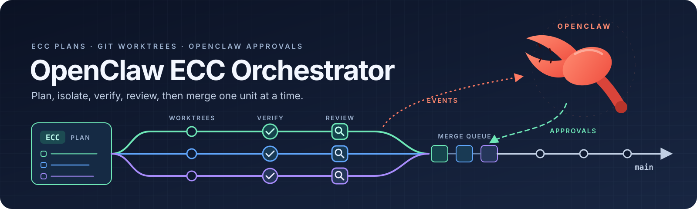
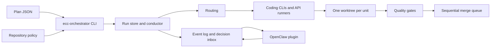

# OpenClaw ECC Orchestrator

[](LICENSE)
[](pyproject.toml)
[](integrations/openclaw-plugin/package.json)

A Python runtime and operator CLI (`ecc-orchestrator`) that takes an ECC task plan, routes each work unit to a certified coding runner, runs it in its own Git worktree, verifies and reviews the result, and merges it through a local sequential queue. An OpenClaw plugin shows the runtime's events and relays approval decisions back to it.

Local setup, the `bin/ecc` wrapper that finds a project's configuration, and project templates live in [ecc-customization](https://github.com/kennylhilljr/ecc-customization). The implementation specification (TEAM-DELIVERY and the migration ledger) lives in the private `agent-control-plane-infra` repository. This repository does not implement chat, identity, session storage, provider billing or a dashboard: OpenClaw owns those, ECC owns workflow doctrine, and Git owns code integration.

[Quick start](#quick-start) · [Configuration](#configuration) · [Commands](#commands-and-examples) · [Testing](#testing) · [Security](#security-boundaries) · [CLI guide](docs/cli.md)

## Architecture and layout



| Path | Responsibility |
| --- | --- |
| [src/openclaw_ecc_orchestrator/cli/](src/openclaw_ecc_orchestrator/cli/) | Operator CLI: argument parser (`main.py`), plans and the confirmation gate, configuration, inbox processor, preflight |
| [src/openclaw_ecc_orchestrator/runs/](src/openclaw_ecc_orchestrator/runs/) | Run store, unit state machine, leases, conductor, plan validation and linting, repair loop, result envelope |
| [src/openclaw_ecc_orchestrator/routing/](src/openclaw_ecc_orchestrator/routing/) | Classification, runner and reviewer selection, escalation, circuit breaker |
| [src/openclaw_ecc_orchestrator/runners/](src/openclaw_ecc_orchestrator/runners/) | Claude Code and Codex adapters, Gemini, Groq, OpenRouter and Kimi HTTP adapters, model discovery, certification |
| [src/openclaw_ecc_orchestrator/team/](src/openclaw_ecc_orchestrator/team/) | Agent team delivery: `team.json`, role rotation, personas, `team-review` and `drive` |
| [worktrees/](src/openclaw_ecc_orchestrator/worktrees/), [gates/](src/openclaw_ecc_orchestrator/gates/), [merge_queue/](src/openclaw_ecc_orchestrator/merge_queue/), [process/](src/openclaw_ecc_orchestrator/process/) | Worktree lifecycle and the shared Git state guard, gate commands, conflict prediction and merging, runner supervision and health checks |
| [src/openclaw_ecc_orchestrator/plugin/](src/openclaw_ecc_orchestrator/plugin/) | Event emitter, `ApprovalBroker`, decision inbox, `required_user_actions` summary |
| [schemas.py](src/openclaw_ecc_orchestrator/schemas.py), [schemas/](schemas/) | Validators for the eight versioned documents and their JSON Schema copies |
| [integrations/openclaw-plugin/](integrations/openclaw-plugin/README.md) | OpenClaw 2026.9.6 plugin: event tailing, `/ecc` commands, Control UI tab, decision files |
| [integrations/launchd/](integrations/launchd/README.md) | launchd templates for the standing inbox processor and weekly recertification |
| [integrations/smoke/](integrations/smoke/roundtrip_smoke.py) | Live round trip through OpenClaw and the inbox processor into a throwaway repository |
| [bin/](bin/) | Shell wrappers: `ecc`, `ecc-decide`, `inbox-processor`, `recertify-weekly`, `roundtrip-smoke`, `with-keychain-secrets` |
| [fixtures/](fixtures/) | Sample plans, work units, handoffs, policy and model catalogs used by the tests |
| [tests/](tests/) | `unittest` suite, including `tests/adversarial/` |
| [AGENTS.md](AGENTS.md), [CLAUDE.md](CLAUDE.md) | Instructions for coding agents working on this repository |

`.kimi-code/` holds agent configuration written by the ECC installer and is not part of this project's code.

The documentation in `docs/` goes deeper than this page:

- [docs/cli.md](docs/cli.md): every subcommand, configuration precedence, exit codes, the confirmation gate, review records and approvals.
- [docs/runtime.md](docs/runtime.md): run state, worktrees, runner supervision, health monitoring, gates, conflict prediction and the merge queue.
- [docs/routing.md](docs/routing.md): document validation, tier, runner and reviewer selection, escalation.
- [docs/runners.md](docs/runners.md): CLI and API runners, model discovery, certification probes.
- [docs/openclaw-events.md](docs/openclaw-events.md): the event log and the approval decision contract with OpenClaw.

## Dependencies and installation

The runtime needs Python 3.11 or newer and Git 2.38 or newer (conflict prediction uses `git merge-tree --write-tree`). It uses the standard library only: `dependencies = []` in [pyproject.toml](pyproject.toml). pytest is an optional `test` extra.

The OpenClaw plugin is plain ESM with no dependencies. Its tests need Node 22 or newer; OpenClaw 2026.9.6 itself needs Node 24.16 or newer.

Real work needs more than the package. Dispatching a unit needs at least one certified runner: the `claude` or `codex` CLI signed in, or an API key for Gemini, Groq, OpenRouter or Kimi in the environment. The `bin/` wrappers, the Keychain helper and the launchd jobs target macOS.

Install from a clone:

```sh
git clone https://github.com/kennylhilljr/openclaw-ecc-orchestrator.git
cd openclaw-ecc-orchestrator
python3.11 -m venv .venv
source .venv/bin/activate
python -m pip install -e .
ecc-orchestrator --version
```

Without installing, either of these runs the same CLI from the repository root:

```sh
PYTHONPATH=src python3.11 -m openclaw_ecc_orchestrator --help
bin/ecc --help
```

`bin/ecc` picks the first Python 3.11 or newer it finds (set `ECC_PYTHON` to choose one) and puts this checkout's `src` on `PYTHONPATH`, so it works from any directory.

## Quick start

This walk through uses a throwaway repository and throwaway state directories, so it touches nothing real. Run it from the repository root with the package installed and the venv active. It uses the sample plan in `fixtures/plans/multi-unit.json`.

```sh
DEMO="$(mktemp -d /tmp/ecc-demo.XXXXXX)"
PLAN="$PWD/fixtures/plans/multi-unit.json"
git init -q -b main "$DEMO/repo"
git -C "$DEMO/repo" -c user.name=demo -c user.email=demo@example.invalid commit -q --allow-empty -m init
export XDG_STATE_HOME="$DEMO/state" XDG_DATA_HOME="$DEMO/data"
cd "$DEMO/repo"
ecc-orchestrator doctor
ecc-orchestrator lint-plan --plan "$PLAN"
```

`doctor` checks Python, Git, the repository and the state and worktree locations without creating anything. `lint-plan` exits 1 here with two `acceptance.path_missing` findings, because the empty repository has none of the files the sample plan names.

Every command that changes state builds a plan first and prints its SHA-256. `--dry-run` shows the plan and changes nothing:

```sh
ecc-orchestrator create-run --run-id demo1 --plan "$PLAN" --allow-lint-findings --dry-run
```

Outside a terminal, a mutating command runs only with `--yes` and a review record for that exact plan. `review-plan --approve` writes the record. The bare `--` separates its own options from the inner command:

```sh
REV="$(ecc-orchestrator review-plan --json --approve --operator demo --session demo-session -- create-run --run-id demo1 --plan "$PLAN" --allow-lint-findings | python3 -c 'import json,sys; print(json.load(sys.stdin)["data"]["review_id"])')"
ecc-orchestrator create-run --run-id demo1 --plan "$PLAN" --allow-lint-findings --yes --review-id "$REV"
ecc-orchestrator status --run-id demo1
ecc-orchestrator events tail
```

`status` shows `generate-schema` ready and `consume-schema` waiting on it. The event log holds `run.created` and the first `unit.state_changed`.

Dispatching fails closed until a runner is certified:

```sh
ecc-orchestrator dispatch --run-id demo1 --unit generate-schema --dry-run
```

This exits 3 with `no eligible certified runner` and a `resolve_needs_user` action. To go further, certify a runner (see [Certify runners and refresh catalogs](#certify-runners-and-refresh-catalogs)) and point `--certifications` at the result. When you are done, `rm -rf "$DEMO"` removes everything the walk through created.

## Configuration

Settings come from command line options first, then the JSON file named by `--config`, then defaults derived from `HOME` and the XDG variables. Paths in the config file resolve relative to the file. Unknown keys are a usage error (exit 2). The full table is in [docs/cli.md](docs/cli.md#configuration).

| Setting | Default and use |
| --- | --- |
| `state_dir` | `$XDG_STATE_HOME/openclaw-ecc-orchestrator`, else `~/.local/state/openclaw-ecc-orchestrator`; runs, approvals, merge queue, review records, logs |
| `worktree_root` | `$XDG_DATA_HOME/openclaw-ecc-orchestrator/worktrees`, else `~/.local/share/openclaw-ecc-orchestrator/worktrees` |
| `repo`, `target_branch` | The working directory and `main` |
| `policy_file` | `<repo>/.orchestration/config.yaml` when it exists |
| `event_log`, `decision_inbox` | `<state_dir>/openclaw-events.jsonl` and `<state_dir>/decisions`; the OpenClaw plugin must name the same paths |
| `certifications` | None, so no runner is certified and assignment fails closed |
| `catalog` | None; API runners then cannot resolve a model |
| `repo_checks`, `tier_costs` | None |
| `conductor_id`, `lease_ttl` | `ecc-cli`, 300 seconds |
| `approval_ttl`, `review_ttl` | 3600 seconds each |
| `runner_timeout`, `gate_timeout` | None; health monitoring stops hung runners instead of a wall clock limit |

The state directory, event log and decision inbox are refused inside the repository, inside any `.git` or `.openclaw` directory, and inside `~/.openclaw`. Any path with a `..` component is refused.

Files read from the target repository:

| File | Use |
| --- | --- |
| `.orchestration/config.yaml` | Repository policy. It is parsed as JSON only, so write it as JSON compatible YAML. It is validated at `create-run` and stored with the run. |
| `.orchestration/team.json` | Agent team settings for `team-review` and `drive`: role panels, `merge_approval` (`human` by default, or `agents`), personas, milestone close steps |
| `.claude/agents/<name>.md` | Persona files named by the `personas` map in `team.json` |

Environment variables:

| Variable | Read by |
| --- | --- |
| `HOME`, `XDG_STATE_HOME`, `XDG_DATA_HOME` | Default state and worktree locations |
| `GEMINI_API_KEY`, `GROQ_API_KEY`, `MOONSHOT_API_KEY`, `OPENROUTER_API_KEY` | API runners and catalog refresh; `bin/with-keychain-secrets` loads them from the macOS Keychain for one command |
| `ECC_PYTHON` | The `bin/` wrappers, to choose the interpreter |
| `ECC_RECERT_RUNNERS` | `bin/recertify-weekly`; default `claude,codex,gemini,groq,kimi` |
| `ECC_GATEWAY_PORT` | `bin/ecc-decide`; default 18789 |

## Commands and examples

`ecc-orchestrator --help` lists the subcommands and `ecc-orchestrator <subcommand> --help` lists each one's options. Every subcommand accepts `--json` for a single result envelope (`ok`, `operation`, `changed`, `checks`, `warnings`, `required_user_actions`, `rollback_checkpoint`, `data`) and `--verbose`.

| Exit code | Meaning |
| --- | --- |
| 0 | ok |
| 1 | the operation failed: a check failed, a plan changed, the operator declined |
| 2 | usage error |
| 3 | an approval or another user action is required; `required_user_actions` says which |

### Plan and create a run

```sh
ecc-orchestrator lint-plan --plan .orchestration/plan.json
ecc-orchestrator plan-check --plan .orchestration/plan.json
ecc-orchestrator create-run --run-id m1 --plan .orchestration/plan.json --dry-run
```

`lint-plan` is read only. `plan-check` asks the architect role for a paid plan review and caches the verdict by plan hash, so `drive` skips its own check for a plan that already passed. `create-run --replace` swaps the plan of an existing run while no unit has left `pending` or `ready`.

### Run one unit by hand

```sh
ecc-orchestrator dispatch --run-id m1 --unit unit-a
ecc-orchestrator verify --run-id m1 --unit unit-a
ecc-orchestrator review --run-id m1 --unit unit-a --reviewer rev1 --runner codex --model MODEL --tier 1 --verdict approved --head SHA --session s1
ecc-orchestrator approvals list
ecc-orchestrator approvals approve REQUEST_ID --operator kenny --session s1
ecc-orchestrator merge --run-id m1 --unit unit-a
```

Replace `MODEL`, `SHA` and `REQUEST_ID` with the values that `status` and `review` print. Run in a terminal, each gated command prints its plan and asks for `y`. `dispatch` launches the real coding runner and blocks until it exits and verification finishes; for rehearsals, `--runner-command-json '<JSON argv>' --allow-test-runner` replaces the runner command. An approving `review` requests a merge approval bound to the verified head, and `merge` runs only once the broker has that approval. Merges stay local: nothing is pushed.

`resume` sends a unit in `needs_user` or `failed` back to `ready`, keeping its worktree and last failure; `--extra-attempts` grants 1 to 3 more attempts. `cleanup` removes a stopped unit's worktree and branch, and with `--archive` it bundles unmerged work first.

### Deliver a milestone with the agent team

```sh
ecc-orchestrator drive --run-id m1 --max-cost-usd 20 --max-hours 4
```

`drive` runs the architect's plan check, then dispatches ready units, sends failures through the repair loop, runs `team-review` on units in review and processes the merge queue until every unit is merged. At the end it runs the milestone review. It stops when a unit needs the owner, when nothing makes progress, at the cost or time limit, or on a product rejection, and it prints `next:` lines with the commands to run. Run it again to continue. Roles on API providers read their keys from the environment, so run it through `bin/with-keychain-secrets` when the keys are in the Keychain.

### Approvals through OpenClaw

The runtime writes events to the event log. The plugin in [integrations/openclaw-plugin](integrations/openclaw-plugin/README.md) shows them in OpenClaw and writes one decision file into the decision inbox per approval. The runtime applies those files only through `ApprovalBroker`, with the same checks as `approvals approve`:

```sh
ecc-orchestrator approvals process-inbox --dry-run
ecc-orchestrator approvals process-inbox --watch --interval 2 --json
bin/ecc-decide list
```

The `--watch` form is the standing processor that `bin/inbox-processor` runs under launchd ([integrations/launchd/README.md](integrations/launchd/README.md)). Only one processor can hold an inbox; a second one exits 3. `bin/ecc-decide` approves or rejects from a terminal through the plugin's gateway method and needs `node` and `openclaw` on `PATH`. `events tail --follow` streams the event log.

### Certify runners and refresh catalogs

```sh
PYTHONPATH=src python3.11 -m openclaw_ecc_orchestrator.runners.certify --runners claude,codex --out /tmp/ecc-cert --dry-run
bin/with-keychain-secrets ecc-orchestrator catalog-refresh --out catalog.json
ecc-orchestrator preflight
```

The certify dry run writes only `/tmp/ecc-cert/plan.json` and calls no model. Without `--dry-run` it runs live probes and writes one certification record per runner plus `summary.json`; point the `certifications` setting at that summary. `bin/recertify-weekly` does the same for five runners and copies the summary to `.orchestration/runtime/cert-latest.json`. `catalog-refresh` fetches live model lists from Gemini, Groq and Kimi by default. `preflight` sends a real unit prompt through every certified coding runner in a throwaway worktree. [docs/runners.md](docs/runners.md) covers the probes and model selection.

## Testing

From the repository root, with Python 3.11 or newer:

```sh
PYTHONPATH=src python3.11 -m unittest discover -s tests -t .
```

The tests create temporary directories, set `HOME` to a temporary path where they run the CLI, and use fake runner scripts instead of real coding CLIs, so they need no network, keys or signed in runners.

`unittest` discovery skips the 18 plain `test_` functions in `tests/test_plan_lint.py`, because they are not `TestCase` methods. pytest runs those too, using the settings in `pyproject.toml`:

```sh
python -m pip install -e ".[test]"
python -m pytest
```

On the commit this README was written against, `unittest` ran 893 tests (OK, 3 skipped) and pytest reported 908 passed and 3 skipped.

The plugin has its own Node suites. The contract suite runs the plugin's decision files through the Python `ApprovalBroker` and needs `python3` 3.11 or newer and `git`:

```sh
(cd integrations/openclaw-plugin && npm test && npm run test:contract)
```

`npm run test:integration` starts a disposable OpenClaw gateway and needs `openclaw` 2026.9.6 installed. `bin/roundtrip-smoke` runs a live round trip through a real OpenClaw gateway and the launchd inbox processor. Neither is automated: this repository has no CI workflow.

## Troubleshooting

| Symptom | What to check |
| --- | --- |
| Many tests fail with `git init` errors and `libxcrun` in stderr | The Python is an x86_64 build running under Rosetta on Apple silicon, so its `git` child processes fail. Use an arm64 Python 3.11 or newer. |
| Most CLI tests fail with `state_dir is inside an .openclaw directory` | `TMPDIR` points inside a `.openclaw` directory. The CLI refuses state there by design; run the tests with `TMPDIR` set elsewhere. |
| `PermissionError` for `ps`, or a few process tests fail | Process liveness uses `ps` on macOS. A sandbox that blocks `ps` breaks some tests in `tests/test_runs_manager.py` and `tests/test_runners_cli_flags.py`. |
| A gated command exits 3 with `confirm_plan` | It ran outside a terminal. Run it in a terminal, or approve the plan with `review-plan --approve` and pass `--yes --review-id`. |
| `dispatch` exits 3 with `no eligible certified runner` | No valid, unexpired certification covers the unit's tier. Certify a runner and set `certifications`. |
| `policy_valid` fails at `create-run` | `.orchestration/config.yaml` contains real YAML syntax. Rewrite it as JSON. |
| `lease_held` | Another conductor id holds an unexpired lease on the run. Wait for it to expire (`lease_ttl`) or stop the other conductor. |
| `approvals process-inbox` exits 3 | Another processor holds the inbox lock. `doctor` reports the holder's pid under `inbox_processor`. |
| launchd jobs log `Operation not permitted` | macOS blocks launchd jobs from reading `~/Documents`. Run them from a worktree outside it, as [integrations/launchd/README.md](integrations/launchd/README.md) describes. |
| API requests fail with `CERTIFICATE_VERIFY_FAILED` | See the TLS note in [docs/runners.md](docs/runners.md#model-discovery). |

## Security boundaries

- **Approvals are bound and single use.** A merge needs a broker approval tied to the run, unit, action, plan hash, session and verified head. A changed plan or a new head voids it, and a consumed approval cannot be replayed.
- **Review records guard against accidents, not attackers.** They are files in the state directory, so anyone who can write there can forge one. They never admit destructive plans.
- **Identity is never inferred.** `approvals approve` and `review-plan --approve` need explicit `--operator` and `--session` handles; email addresses and secret looking handles are refused. Decisions from OpenClaw carry the `decided_by` that OpenClaw attests.
- **Redaction is heuristic.** Every printed string, event and handoff passes through the redaction engine, which masks values under secret looking keys and known token shapes. It can miss a credential, so do not paste runner logs or state files into issues.
- **Keys stay in the environment.** API keys travel only in request headers. `bin/with-keychain-secrets` exports them into one command's environment and prints only their names, and the orchestrator passes each key only to its own provider's worker.
- **Guard rails are not a sandbox.** Protected command globs and the shared Git state guard catch mistakes, but runners and gate commands run with the operator's filesystem permissions.
- **Keep real state out of development.** Never point the CLI, tests or plugin at `~/.local/state`, `~/.local/share`, `~/.openclaw` or a production OpenClaw config while developing. `.env` files are ignored, and [.gitleaks.toml](.gitleaks.toml) configures secret scanning.

## Contributing

Read [AGENTS.md](AGENTS.md) first. Keep the runtime and the tests on the standard library, keep new commands on the result envelope shape, and update the matching file in `schemas/` when a document in `schemas.py` changes (`tests/test_schemas_json.py` checks that they agree). `docs/cli.md` writes option names without their leading hyphens and uses no double hyphen, em dash or en dash; `tests/test_cli.py` enforces this. Add a regression test with each bug fix, and run pytest and the plugin's unit and contract suites before opening a pull request.

## License

[MIT](LICENSE), copyright (c) 2026 Kenny.
